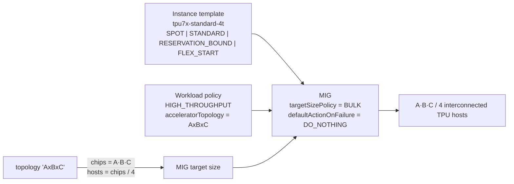

# TPU7x (Ironwood) multi-host slices on Compute Engine — Terraform

A reusable Terraform module that provisions **any size of TPU7x slice** through a
**multi-host managed instance group (MIG)** using only the Compute Engine API, with
support for **DWS calendar-mode reservations** (reservation-bound), Spot, on-demand
and flex-start capacity.

Based on
[Create a MIG with multi-host TPU slice](https://docs.cloud.google.com/compute/docs/tpus/create-tpu-mig-multi-host-slice)
and
[Future reservations in calendar mode](https://docs.cloud.google.com/compute/docs/instances/future-reservations-calendar-mode-overview).

```
hrt-terraform/
├── custom_image.md                 # tutorial: custom Debian 12 OS image for TPU7x
├── modules/
│   └── tpu7x-mig-slice/            # instance template + workload policy + MIG  (any topology)
└── examples/
    ├── spot-2x2x2/                 # ✅ tested: 2x2x2 (8 chips, 2 hosts) on Spot
    └── calendar-reservation/       # slice bound to an EXISTING DWS calendar reservation
```

## How a slice is built



| Topology | Chips | Hosts | | Topology | Chips | Hosts |
|---|---:|---:|---|---|---:|---:|
| 2x2x1 | 4 | 1 | | 4x4x4 | 64 | 16 |
| 2x2x2 | 8 | 2 | | 4x4x8 | 128 | 32 |
| 2x2x4 | 16 | 4 | | 4x8x8 | 256 | 64 |
| 2x4x4 | 32 | 8 | | 8x8x8 | 512 | 128 |
| | | | | 8x8x16 / 8x16x16 | 1024 / 2048 | 256 / 512 |

## Quick start — Spot 2x2x2 (the tested path)

```bash
cd examples/spot-2x2x2
terraform init
terraform apply -var project_id=YOUR_PROJECT -var zone=us-central1-c
# → 2 × tpu7x-standard-4t Spot hosts forming one 2x2x2 slice
terraform output list_instances_command
terraform destroy -var project_id=YOUR_PROJECT -var zone=us-central1-c
```

To test a single-host `2x2x1` slice (4 chips, 1 VM), pass `-var topology=2x2x1`.

To use a custom **Debian 12** OS image instead of the default Ubuntu accelerator image, see [custom_image.md](./custom_image.md) and pass `-var source_image=projects/YOUR_PROJECT/global/images/family/debian-12-tpu7x`.

To attach per-VM non-boot read-write **Hyperdisk Balanced** data disks, pass `data_disk_count` (and optionally `data_disk_size_gb`, `data_disk_provisioned_iops`, and `data_disk_provisioned_throughput`):

```bash
terraform apply \
  -var project_id=YOUR_PROJECT \
  -var zone=us-central1-c \
  -var data_disk_count=2 \
  -var data_disk_size_gb=500 \
  -var data_disk_provisioned_iops=150000 \
  -var data_disk_provisioned_throughput=2400
```

## Quick start — existing DWS calendar reservation

1. Create / get a calendar-mode future reservation approved (console or
   `gcloud compute future-reservations create … --reservation-mode=CALENDAR --tpu-version=TPU7X --chip-count=N`).
   To see when/where capacity is available first:
   `gcloud beta compute advice calendar-mode --region REGION --tpu-version TPU7X --chip-count N --duration-range min=1d,max=7d --start-time-range from=…,to=… --end-time-range from=…,to=…`
2. Find the auto-created reservation name (defaults to the future reservation name):

   ```bash
   gcloud compute future-reservations describe FR_NAME --zone ZONE \
     --format='value(reservationName,status.procurementStatus,timeWindow.startTime,timeWindow.endTime)'
   ```

3. Bind the slice to it:

   ```bash
   cd examples/calendar-reservation
   terraform init
   # before start_time: pre-create the MIG at size 0
   terraform apply -var project_id=YOUR_PROJECT -var zone=ZONE -var topology=4x4x4 -var reservation_name=RES_NAME
   # once the window is open: bring up the slice
   terraform apply -var project_id=YOUR_PROJECT -var zone=ZONE -var topology=4x4x4 -var reservation_name=RES_NAME -var activate_slice=true
   # optional: pass -var source_image=projects/YOUR_PROJECT/global/images/family/debian-12-tpu7x for a custom Debian 12 image (see custom_image.md)
   ```

Or straight from the module:

```hcl
module "slice" {
  source             = "./modules/tpu7x-mig-slice"
  project_id         = "my-project"
  name               = "ironwood-train"
  zone               = "us-central1-c"           # reservation's zone
  topology           = "4x4x4"
  provisioning_model = "RESERVATION_BOUND"
  reservation_name   = "my-calendar-res"         # auto-created reservation of the future reservation
}
```

## TPU Health & Initialization Verification

Each `tpu7x-standard-4t` host has **4 TPU7x chips** (**8 TensorCore devices** per host). After the MIG reaches `STABLE`, use the following checks to verify OS/driver binding, `tpu-info`, `jax.devices()`, `jax.device_count()`, and Inter-Chip Interconnect (ICI) collectives on both single-host (`2x2x1`) and multi-node (`2x2x2`+) slices.

### 1. Install Python 3.12, `jax[tpu]`, and `tpu-info` on Each Host

Run on the target VM(s) (using `uv` so Python 3.12 works out-of-the-box on both Ubuntu 24.04 and Debian 12):

```bash
export PATH="$HOME/.local/bin:$PATH"
command -v uv >/dev/null 2>&1 || (curl -LsSf https://astral.sh/uv/install.sh | sh)

uv venv --python 3.12 --clear /tmp/py312-venv
uv pip install --python /tmp/py312-venv/bin/python \
  "jax[tpu]==0.11.2" \
  tpu-info \
  -f https://storage.googleapis.com/jax-releases/libtpu_releases.html
```

### 2. Single-Machine (`2x2x1`) Health, `tpu-info`, JAX Init & ICI Test

SSH into the VM and verify driver binding, `tpu-info`, `jax.devices()`, `jax.device_count()`, matmul compute, and intra-host ICI `psum` collective across all 8 cores:

```bash
# Load GCE TPU runtime environment variables (TOPOLOGY, CHIPS_PER_HOST_BOUNDS, etc.)
set -a
source /home/tpu-runtime/tpu-env
set +a

# 1. Verify PCI/VFIO binding & vBar agent
lspci -nnk -d 1ae0:0076
ls -la /dev/vfio/
systemctl is-active vbar-control-agent.service || pgrep -fa vbar_control_agent

# 2. Check TPU chip detection & utilization via tpu-info
/tmp/py312-venv/bin/tpu-info

# 3. Verify JAX initialization, device_count(), devices(), matmul, and ICI collective
/tmp/py312-venv/bin/python - << 'EOF'
import jax
import jax.numpy as jnp

print("Python jax.__version__:", jax.__version__)
print("JAX backend:", jax.default_backend())
print("jax.device_count():", jax.device_count())
print("jax.local_device_count():", jax.local_device_count())
print("jax.devices():", jax.devices())

assert jax.default_backend() == "tpu", f"Expected 'tpu' backend, got {jax.default_backend()}"
assert jax.device_count() == 8, f"Expected 8 TPU7x cores on 2x2x1, got {jax.device_count()}"

# Single-device matmul test
x = jnp.ones((1024, 1024), dtype=jnp.float32)
y = jnp.dot(x, x)
print("Matmul result sum:", float(jnp.sum(y)))
assert float(jnp.sum(y)) == 1024.0 ** 3

# Intra-host ICI collective (all-reduce psum across all 8 TPU7x cores)
n = jax.device_count()
xs = jnp.arange(n, dtype=jnp.float32)
res = jax.pmap(lambda a: jax.lax.psum(a, "i"), axis_name="i")(xs)
print("pmap psum across 8 TPU7x cores:", res)
assert jnp.all(res == sum(range(n))), "ICI psum mismatch"
print("✅ Single-host TPU7x initialization and ICI collective verified successfully!")
EOF
```

Expected output on a healthy `2x2x1` host:

```text
Python jax.__version__: 0.11.2
JAX backend: tpu
jax.device_count(): 8
jax.local_device_count(): 8
jax.devices(): [TpuDevice(id=0, process_index=0, coords=(0,0,0), core_on_chip=0), ..., TpuDevice(id=7, process_index=0, coords=(1,1,0), core_on_chip=1)]
Matmul result sum: 1073741824.0
pmap psum across 8 TPU7x cores: [28. 28. 28. 28. 28. 28. 28. 28.]
✅ Single-host TPU7x initialization and ICI collective verified successfully!
```

### 3. Multi-Node (`2x2x2`+) Distributed JAX Init & Cross-Host ICI Test

On a multi-host slice (e.g., `2x2x2` = 2 hosts / 16 cores, `4x4x4` = 16 hosts / 128 cores), every VM in the MIG must run the test script simultaneously so `jax.distributed.initialize()` forms the global multi-host mesh and exercises the cross-host ICI links.

Run the following from your workstation to execute `tpu-info`, `jax.distributed.initialize()`, `jax.device_count()`, `jax.devices()`, and a cross-host ICI `jax.pmap` `psum` all-reduce in parallel across all hosts in the MIG:

```bash
export PROJECT_ID="YOUR_PROJECT"
export ZONE="us-central1-c"
export MIG_NAME="tpu7x-spot-2x2x2"

# Collect all RUNNING instance names in the MIG
mapfile -t INSTANCES < <(
  gcloud compute instance-groups managed list-instances "${MIG_NAME}" \
    --project="${PROJECT_ID}" \
    --zone="${ZONE}" \
    --format="value(instance.basename())"
)
echo "Testing ${#INSTANCES[@]} hosts in ${MIG_NAME}: ${INSTANCES[*]}"

# Launch the multi-node JAX + ICI collective check across all hosts in parallel
for inst in "${INSTANCES[@]}"; do
  gcloud compute ssh "${inst}" \
    --project="${PROJECT_ID}" \
    --zone="${ZONE}" \
    --tunnel-through-iap \
    --command='
      set -e
      export PATH="$HOME/.local/bin:$PATH"
      if [ ! -x /tmp/py312-venv/bin/python ]; then
        command -v uv >/dev/null 2>&1 || (curl -LsSf https://astral.sh/uv/install.sh | sh)
        uv venv --python 3.12 --clear /tmp/py312-venv
        uv pip install --python /tmp/py312-venv/bin/python \
          "jax[tpu]==0.11.2" tpu-info \
          -f https://storage.googleapis.com/jax-releases/libtpu_releases.html
      fi

      set -a
      source /home/tpu-runtime/tpu-env
      set +a

      echo "=== [$(hostname)] tpu-info ==="
      /tmp/py312-venv/bin/tpu-info

      echo "=== [$(hostname)] Multi-Node JAX + Cross-Host ICI Test ==="
      /tmp/py312-venv/bin/python - << "PYEOF"
import os
import jax
import jax.numpy as jnp

jax.distributed.initialize()

proc_id = jax.process_index()
num_procs = jax.process_count()
total_devices = jax.device_count()
local_devices = jax.local_device_count()

print(f"[process {proc_id}/{num_procs}] backend={jax.default_backend()} "
      f"local_device_count={local_devices} total_device_count={total_devices}")
if proc_id == 0:
    print("Global jax.devices():", jax.devices())

assert jax.default_backend() == "tpu"
assert local_devices == 8, f"Expected 8 local cores per host, got {local_devices}"
assert total_devices == num_procs * 8, f"Expected {num_procs * 8} total cores, got {total_devices}"

# Cross-host ICI collective: all-reduce psum across every core on every host
local_xs = jnp.arange(local_devices, dtype=jnp.float32) + (proc_id * local_devices)
res = jax.pmap(lambda x: jax.lax.psum(x, "i"), axis_name="i")(local_xs)
expected = sum(range(total_devices))
print(f"[process {proc_id}/{num_procs}] cross-host pmap psum result: {res} (expected {expected})")
assert jnp.all(res == expected), f"Cross-host ICI psum mismatch: {res} != {expected}"

if proc_id == 0:
    print(f"✅ Multi-node TPU7x slice ({num_procs} hosts, {total_devices} cores) "
          f"and cross-host ICI interconnect verified successfully!")
PYEOF
    ' &
done
wait
```

## Provisioning models at a glance

| `provisioning_model` | Capacity source | Quota needed | VM end-of-life |
|---|---|---|---|
| `SPOT` | preemptible pool | `PREEMPTIBLE-TPU7X-*` | `STOP` (default) or `DELETE` on preemption |
| `STANDARD` | on-demand (or a standard reservation via `reservation_name`) | `TPU7X-*` | – |
| `RESERVATION_BOUND` | a specific reservation, e.g. DWS **calendar** auto-created reservation | none | `DELETE` at reservation end |
| `FLEX_START` | DWS flex-start queue | `TPU7X-*` | `DELETE` after `max_run_duration` |

## Prerequisites

* Terraform ≥ 1.5, `hashicorp/google` ≥ 7.28 (verified with 8.7.0)
* A VPC/subnet in the target region; TPU7x zones at the time of writing include
  `us-central1-b`, `us-central1-c`, `us-central1-ai1a`, `us-east1-b`, `us-east5-a`
  (check `gcloud compute machine-types list --filter="name=tpu7x-standard-4t"`)
* For calendar reservations: an approved future reservation in the slice's zone
  (Terraform does not create the request; the native provider resource does not yet
  accept the TPU7x VM family).
