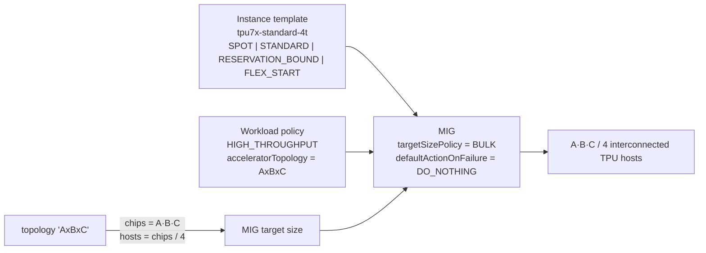

# TPU7x (Ironwood) multi-host slices on Compute Engine — Terraform

A reusable Terraform module that provisions **any size of TPU7x slice** through a
**multi-host managed instance group (MIG)** using only the Compute Engine API, with
support for **DWS calendar-mode reservations** (reservation-bound), Spot, on-demand
and flex-start capacity.

Based on
[Create a MIG with multi-host TPU slice](https://docs.cloud.google.com/compute/docs/tpus/create-tpu-mig-multi-host-slice)
and
[Future reservations in calendar mode](https://docs.cloud.google.com/compute/docs/instances/future-reservations-calendar-mode-overview).

```
hrt-terraform/
├── custom_image.md                 # tutorial: custom Debian 12 OS image for TPU7x
├── modules/
│   └── tpu7x-mig-slice/            # instance template + workload policy + MIG  (any topology)
└── examples/
    ├── spot-2x2x2/                 # ✅ tested: 2x2x2 (8 chips, 2 hosts) on Spot
    └── calendar-reservation/       # slice bound to an EXISTING DWS calendar reservation
```

## How a slice is built



| Topology | Chips | Hosts | | Topology | Chips | Hosts |
|---|---:|---:|---|---|---:|---:|
| 2x2x2 | 8 | 2 | | 4x4x8 | 128 | 32 |
| 2x2x4 | 16 | 4 | | 4x8x8 | 256 | 64 |
| 2x4x4 | 32 | 8 | | 8x8x8 | 512 | 128 |
| 4x4x4 | 64 | 16 | | 8x8x16 / 8x16x16 | 1024 / 2048 | 256 / 512 |

## Quick start — Spot 2x2x2 (the tested path)

```bash
cd examples/spot-2x2x2
terraform init
terraform apply -var project_id=YOUR_PROJECT -var zone=us-central1-c
# → 2 × tpu7x-standard-4t Spot hosts forming one 2x2x2 slice
terraform output list_instances_command
terraform destroy -var project_id=YOUR_PROJECT -var zone=us-central1-c
```

To use a custom **Debian 12** OS image instead of the default Ubuntu accelerator image, see [custom_image.md](./custom_image.md) and pass `-var source_image=projects/YOUR_PROJECT/global/images/family/debian-12-tpu7x`.

## Quick start — existing DWS calendar reservation

1. Create / get a calendar-mode future reservation approved (console or
   `gcloud compute future-reservations create … --reservation-mode=CALENDAR --tpu-version=TPU7X --chip-count=N`).
   To see when/where capacity is available first:
   `gcloud beta compute advice calendar-mode --region REGION --tpu-version TPU7X --chip-count N --duration-range min=1d,max=7d --start-time-range from=…,to=… --end-time-range from=…,to=…`
2. Find the auto-created reservation name (defaults to the future reservation name):

   ```bash
   gcloud compute future-reservations describe FR_NAME --zone ZONE \
     --format='value(reservationName,status.procurementStatus,timeWindow.startTime,timeWindow.endTime)'
   ```

3. Bind the slice to it:

   ```bash
   cd examples/calendar-reservation
   terraform init
   # before start_time: pre-create the MIG at size 0
   terraform apply -var project_id=YOUR_PROJECT -var zone=ZONE -var topology=4x4x4 -var reservation_name=RES_NAME
   # once the window is open: bring up the slice
   terraform apply -var project_id=YOUR_PROJECT -var zone=ZONE -var topology=4x4x4 -var reservation_name=RES_NAME -var activate_slice=true
   ```

Or straight from the module:

```hcl
module "slice" {
  source             = "./modules/tpu7x-mig-slice"
  project_id         = "my-project"
  name               = "ironwood-train"
  zone               = "us-central1-c"           # reservation's zone
  topology           = "4x4x4"
  provisioning_model = "RESERVATION_BOUND"
  reservation_name   = "my-calendar-res"         # auto-created reservation of the future reservation
}
```

## Provisioning models at a glance

| `provisioning_model` | Capacity source | Quota needed | VM end-of-life |
|---|---|---|---|
| `SPOT` | preemptible pool | `PREEMPTIBLE-TPU7X-*` | `STOP` (default) or `DELETE` on preemption |
| `STANDARD` | on-demand (or a standard reservation via `reservation_name`) | `TPU7X-*` | – |
| `RESERVATION_BOUND` | a specific reservation, e.g. DWS **calendar** auto-created reservation | none | `DELETE` at reservation end |
| `FLEX_START` | DWS flex-start queue | `TPU7X-*` | `DELETE` after `max_run_duration` |

## Prerequisites

* Terraform ≥ 1.5, `hashicorp/google` ≥ 7.28 (verified with 8.7.0)
* A VPC/subnet in the target region; TPU7x zones at the time of writing include
  `us-central1-b`, `us-central1-c`, `us-central1-ai1a`, `us-east1-b`, `us-east5-a`
  (check `gcloud compute machine-types list --filter="name=tpu7x-standard-4t"`)
* For calendar reservations: an approved future reservation in the slice's zone
  (Terraform does not create the request; the native provider resource does not yet
  accept the TPU7x VM family).
